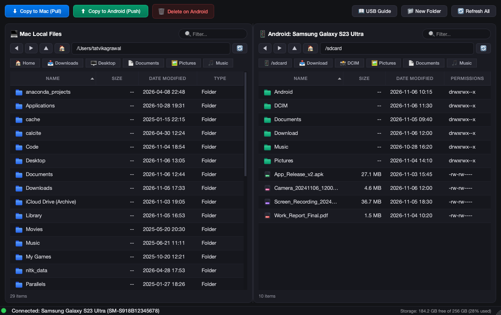

# Android File Manager for macOS

A modern, standalone graphical Android File Manager for macOS Apple Silicon & Intel built with **Python 3**, **PyQt6**, and **Android Debug Bridge (ADB)**.



---

## ✨ Features

- **Dual-Pane File Explorer**:
  - **Left Pane (Mac)**: Browse local files (defaults to your macOS Home directory `~`).
  - **Right Pane (Android)**: Full access to Android internal storage (`/storage/emulated/0`, `DCIM`, `Download`, `Pictures`, `Documents`, `Music`, `Movies`).
- **In-Place File Viewing & Quick Look**:
  - 👁️ **Spacebar Quick Look**: Instant macOS Quick Look preview for photos, videos, PDFs, and audio directly from your phone.
  - ↗️ **Direct Open**: Double-click or press <kbd>Return</kbd> on any file to open it in macOS default viewer (Preview, QuickTime, TextEdit) without polluting your active working directory.
- **Full Keyboard Navigation**:
  - <kbd>Return</kbd> or <kbd>Enter</kbd>: Open highlighted folder or file
  - <kbd>⌘</kbd> + <kbd>↓</kbd> or <kbd>⌘</kbd> + <kbd>O</kbd>: Open selected folder or file
  - <kbd>⌘</kbd> + <kbd>↑</kbd> or <kbd>Backspace</kbd>: Navigate up to parent folder
  - <kbd>⇧</kbd> + <kbd>⌘</kbd> + <kbd>N</kbd>: Create a new folder
  - <kbd>⌘</kbd> + <kbd>[</kbd> / <kbd>⌘</kbd> + <kbd>]</kbd>: History back & forward
- **Fast Transfers & Safety**:
  - ⬇️ **Copy to Mac (Pull)**: Pull selected files or directories from Android to Mac (<kbd>⌘</kbd> + <kbd>←</kbd>).
  - ⬆️ **Copy to Android (Push)**: Push selected files or directories from Mac to Android (<kbd>⌘</kbd> + <kbd>→</kbd>).
  - 🗑️ **Delete Safety**: Safe deletion with explicit confirmation dialogs.
  - 📁 **New Folder & Rename**: Full directory creation and renaming on both platforms.
- **Dynamic Device Monitoring**:
  - Real-time connection status indicator (🟢 Connected, 🟡 Unauthorized, 🔴 Disconnected, 🟠 Debugging Disabled).
  - Background polling via `adb devices -l` showing device model, serial number, and storage capacity.
  - Automatic detection of **"Unauthorized"** state with an actionable guidance banner.
- **Native macOS Experience**:
  - Custom 3D folder squircle application icon (`AppIcon.icns`).
  - Dark mode aesthetic matching macOS Sonoma and Sequoia.
  - Asynchronous background worker threads (`QThread`) ensuring the UI never freezes during large file transfers.

---

## 📋 Prerequisites

1. **macOS 12.0+** (Apple Silicon or Intel).
2. **Python 3.10+**.
3. **Android Platform Tools (ADB)**:
   ```bash
   brew install android-platform-tools
   ```
4. **Android Phone**:
   - Enable **Developer Options** (tap *Build Number* 7 times in *Settings > About Phone*).
   - Enable **USB Debugging** in *Developer Options*.
   - Connect phone via USB cable and tap **"Allow"** on the RSA authorization popup.

---

## 🚀 Quick Start (Running from Source)

```bash
# 1. Clone the repository
git clone https://github.com/your-username/android-file-manager.git
cd android-file-manager

# 2. Create and activate a virtual environment
python3 -m venv .venv
source .venv/bin/activate

# 3. Install dependencies
pip install -r requirements.txt

# 4. Run the application
python main.py
```

---

## 📦 Building Standalone macOS `.app` Bundle

Compile the app into a standalone Apple Silicon macOS `.app` bundle:

```bash
./build_app.sh
```

The script compiles the application via PyInstaller, attaches the custom app icon, and installs the bundle directly to your Desktop:
```bash
open "$HOME/Desktop/Android File Manager.app"
```

---

## 🧪 Running Tests

The test suite includes 15+ automated unit and integration tests covering ADB parsing, path normalization, proxy models, and keyboard navigation:

```bash
.venv/bin/python -m unittest discover tests
```

---

## 📂 Project Architecture

```
android-file-manager/
├── main.py                     # Application entry point
├── main_window.py              # Main dual-pane window and event orchestration
├── adb_manager.py              # ADB CLI wrapper, command builder, and path normalizer
├── file_models.py              # Local & remote file table models and proxy filtering
├── ui_components.py            # PathBar, FileTableView, StatusIndicator, and Dialogs
├── styles.py                   # macOS Sonoma/Sequoia dark mode styling
├── workers.py                  # Background QThread workers for async transfers & polling
├── build_app.sh                # Automated build and packaging script
├── requirements.txt            # Python dependencies
├── AppIcon.icns                # Multi-resolution macOS application icon
├── app_icon.png                # High-resolution application icon
├── SETUP_GUIDE.txt             # Step-by-step setup and troubleshooting guide
└── tests/                      # Automated test suite
    ├── test_adb.py             # ADB parsing & device status unit tests
    └── test_ui.py              # PyQt6 UI and navigation integration tests
```

---

## ⌨️ Keyboard Shortcuts Reference

| Shortcut | Action |
| :--- | :--- |
| <kbd>Return</kbd> / <kbd>Enter</kbd> | Open selected folder or launch file viewer |
| <kbd>⌘</kbd> + <kbd>↓</kbd> / <kbd>⌘</kbd> + <kbd>O</kbd> | Open selected item |
| <kbd>⌘</kbd> + <kbd>↑</kbd> / <kbd>Backspace</kbd> | Navigate up to parent directory |
| <kbd>Space</kbd> | macOS Quick Look preview |
| <kbd>⌘</kbd> + <kbd>←</kbd> | Copy selected Android items to Mac (Pull) |
| <kbd>⌘</kbd> + <kbd>→</kbd> | Copy selected Mac items to Android (Push) |
| <kbd>⇧</kbd> + <kbd>⌘</kbd> + <kbd>N</kbd> | Create New Folder in active pane |
| <kbd>Delete</kbd> | Delete selected items (with confirmation) |
| <kbd>⌘</kbd> + <kbd>[</kbd> / <kbd>⌥</kbd> + <kbd>←</kbd> | History Back |
| <kbd>⌘</kbd> + <kbd>]</kbd> / <kbd>⌥</kbd> + <kbd>→</kbd> | History Forward |

---

## 📄 License

This project is licensed under the MIT License - see the [LICENSE](LICENSE) file for details.
